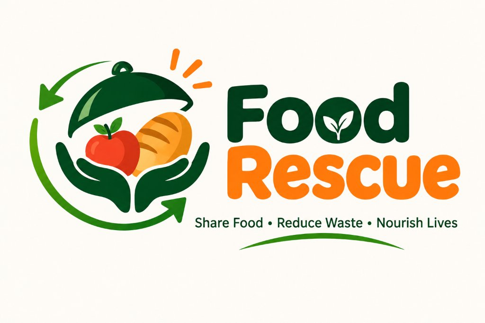
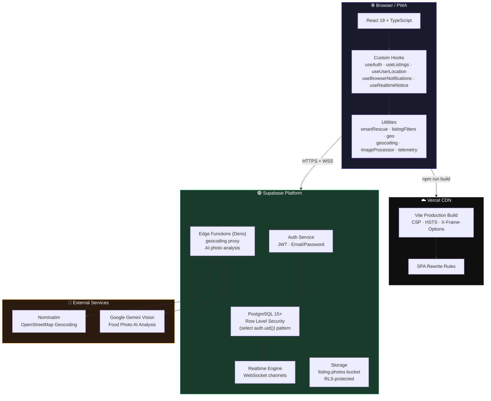
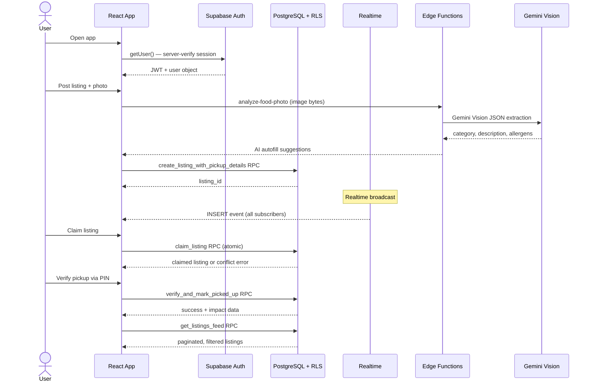
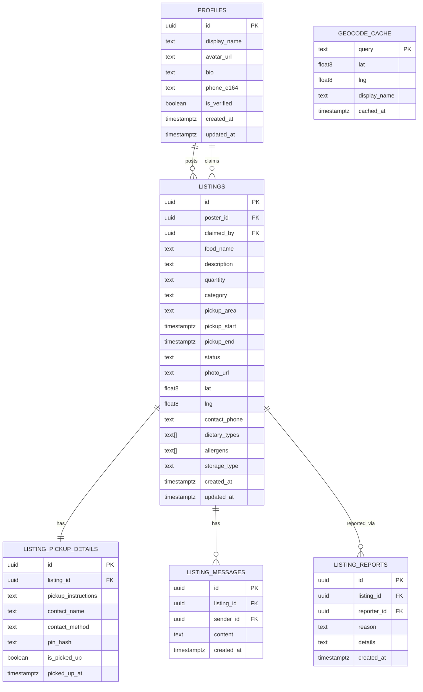
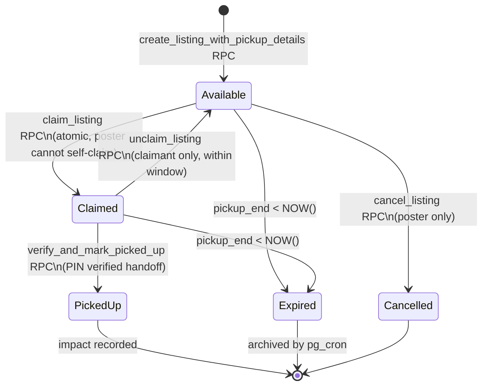
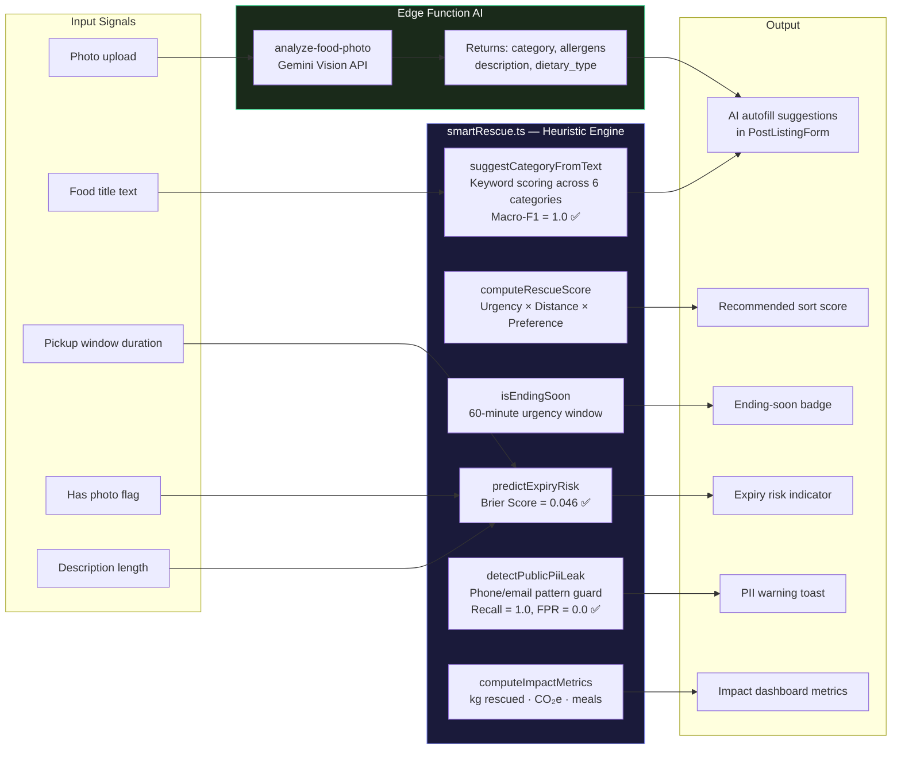
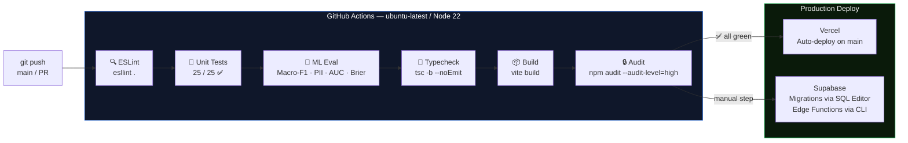

<div align="center">



[](https://github.com/still-trying/food-rescue/actions/workflows/ci.yml)
[](https://react.dev)
[](https://www.typescriptlang.org)
[](https://vitejs.dev)
[](https://tailwindcss.com)
[](https://supabase.com)
[](https://www.postgresql.org)
[](https://vercel.com)
[](./LICENSE)
[](https://nodejs.org)

**[🌐 Live Demo](#)** · **[🐛 Report Bug](../../issues)** · **[✨ Request Feature](../../issues)**

</div>

---

## 📚 Table of Contents

- [What is Food Rescue?](#-what-is-food-rescue)
- [Core User Flow](#-core-user-flow)
- [System Architecture](#-system-architecture)
- [Data Flow](#-data-flow)
- [Database Schema](#-database-schema)
- [Listing Lifecycle](#-listing-lifecycle)
- [Security Architecture](#-security-architecture)
- [ML & AI Layer](#-ml--ai-layer)
- [CI/CD Pipeline](#-cicd-pipeline)
- [Project Structure](#-project-structure)
- [Feature Set](#-feature-set)
- [Tech Stack](#-tech-stack)
- [Getting Started](#-getting-started)
- [Environment Variables](#-environment-variables)
- [Supabase Setup](#-supabase-setup)
- [Edge Functions](#-edge-functions)
- [Deployment](#-deployment)
- [Testing](#-testing)
- [Performance](#-performance)
- [Roadmap](#-roadmap)
- [Contributing](#-contributing)
- [License](#-license)

---

## 🌱 What is Food Rescue?

Food Rescue is a **production-grade, full-stack Progressive Web App** that connects surplus food donors with people nearby who can use it — before it becomes waste.

Restaurants, home kitchens, bakeries, grocers, and individuals can post listings in seconds. Nearby authenticated users can discover, claim, and pick up food in real time.

> [!IMPORTANT]
> **Core lifecycle:** `Available → Claimed → Picked Up`
>
> Listings auto-expire when their pickup window closes. Stale browser tabs are protected against invalid claims via server-side RPC guards.

---

## 🔄 Core User Flow

```mermaid
flowchart LR
    A(["📤 Post Listing"])
    B(["🔍 Discover Feed"])
    C(["📍 Locate on Map"])
    D(["🤝 Claim"])
    E(["🔑 PIN Handoff"])
    F(["✅ Picked Up"])
    G(["♻️ Impact Logged"])

    A --> B
    B --> C
    C --> D
    D --> E
    E --> F
    F --> G

    style A fill:#FFD166,stroke:#b8860b,color:#000000
    style B fill:#06D6A0,stroke:#04795a,color:#000000
    style C fill:#118AB2,stroke:#0b5c73,color:#ffffff
    style D fill:#8338EC,stroke:#5b0fb3,color:#ffffff
    style E fill:#FF6B6B,stroke:#c0392b,color:#ffffff
    style F fill:#3ECF8E,stroke:#1a7a52,color:#000000
    style G fill:#EF476F,stroke:#a3223f,color:#ffffff
```



---

## 🏗️ System Architecture



---

## 🔀 Data Flow



---

## 🗄️ Database Schema



---

## 🔄 Listing Lifecycle



---

## 🔐 Security Architecture

```mermaid
flowchart TD
    subgraph RLS["Row Level Security — PostgreSQL"]
        P1["listings: SELECT\nTO authenticated\nUSING (true for available,\nor (select auth.uid()) = poster_id)"]
        P2["listings: INSERT\nTO authenticated\nWITH CHECK ((select auth.uid()) = poster_id)"]
        P3["listings: UPDATE\nTO authenticated\nUSING (atomic RPC guards only)"]
        P4["listing_pickup_details: SELECT\nTO authenticated\nUSING ((select auth.uid()) = listing.poster_id\nOR (select auth.uid()) = listing.claimed_by)"]
    end

    subgraph RPCs["SECURITY DEFINER RPCs\nsearch_path = public, pg_temp"]
        R1["claim_listing\n— atomicity guard\n— expiry check\n— self-claim block"]
        R2["verify_and_mark_picked_up\n— PIN bcrypt verify\n— claimant-only"]
        R3["cancel_listing / unclaim_listing\n— poster / claimant only\n— state machine guards"]
        R4["report_listing\n— duplicate prevention\n— rate-limited"]
        R5["send_listing_message\n— participant-only\n— rate-limited (10/min)"]
        R6["edit_listing\n— poster-only\n— immutable field guard"]
    end

    subgraph FrontEnd["Frontend Security"]
        F1["getUser() on startup\nServer-verified JWT"]
        F2["Magic-byte image validation\nJPEG/PNG/WebP only"]
        F3["PII detection before submit\nphone/email scrubbing"]
        F4["CSP headers via Vercel\nno unsafe-eval / unsafe-inline"]
        F5["HSTS preload\nX-Frame-Options: DENY"]
    end

    subgraph DB_Extra["Database Extras"]
        D1["REVOKE ALL FROM anon\non sensitive tables"]
        D2["protect_profile_verification_flag\ntrigger — prevents self-promotion"]
        D3["enforce_listing_limits trigger\n≤10 active listings per user"]
    end

    RLS --> RPCs
    RPCs --> FrontEnd
    DB_Extra --> RLS
```



---

## 🤖 ML & AI Layer



---

## 🚀 CI/CD Pipeline



---

## 📁 Project Structure

```
food-rescue/
├── 📂 .github/
│   ├── workflows/ci.yml          # GitHub Actions — lint, test, ML eval, build, audit
│   └── dependabot.yml            # Automated dependency updates
│
├── 📂 public/
│   ├── manifest.webmanifest      # PWA manifest
│   └── icon-{192,512}.png        # App icons
│
├── 📂 src/
│   ├── 📂 components/            # React UI components
│   │   ├── Auth.tsx              # Login / signup
│   │   ├── EditListingModal.tsx  # In-place listing editor
│   │   ├── ErrorBoundary.tsx     # React error boundary
│   │   ├── FilterBar.tsx         # Category / distance / sort filters
│   │   ├── Header.tsx            # App header + profile button
│   │   ├── ImpactDashboard.tsx   # Rescue impact metrics
│   │   ├── ListingActions.tsx    # Claim / cancel / edit / report / PIN
│   │   ├── ListingCard.tsx       # Individual listing card
│   │   ├── ListingFeed.tsx       # Virtualized listing list
│   │   ├── ListingsMap.tsx       # Canvas map with Haversine pins
│   │   ├── ListingStatusBadge.tsx# Status pill UI
│   │   ├── NavTabs.tsx           # Tab navigation
│   │   ├── PickupChatPanel.tsx   # Poster ↔ Claimant messaging
│   │   ├── PickupDetailsPanel.tsx# Pickup instructions view
│   │   ├── PostListingForm.tsx   # New listing form + AI autofill
│   │   ├── ProfileModal.tsx      # User profile editor
│   │   ├── RealtimeBanner.tsx    # Realtime status + notification toggle
│   │   └── ResetPasswordModal.tsx# Password recovery
│   │
│   ├── 📂 constants/
│   │   └── categories.ts         # FOOD_CATEGORIES, DIETARY_OPTIONS, ALLERGENS
│   │
│   ├── 📂 hooks/                 # Custom React hooks
│   │   ├── useAuth.ts            # Auth state + server-verify getUser()
│   │   ├── useBrowserNotifications.ts # Web Push opt-in
│   │   ├── useListings.ts        # Realtime + RPC feed + snapshot merge
│   │   ├── useNowTick.ts         # 1-min clock tick for expiry UI
│   │   ├── useRealtimeNotice.ts  # Toast on realtime events
│   │   └── useUserLocation.ts    # Geolocation API wrapper
│   │
│   ├── 📂 lib/
│   │   └── supabase.ts           # Typed Supabase client (dual env)
│   │
│   ├── 📂 types/
│   │   ├── database.ts           # Full DB schema TypeScript types
│   │   └── listing.ts            # Domain types: Listing, View, SortOption
│   │
│   ├── 📂 utils/                 # Pure utility functions
│   │   ├── date.ts               # Relative date + expiry helpers
│   │   ├── geo.ts                # Haversine distance calculation
│   │   ├── geocoding.ts          # TTL/LRU geocoding cache
│   │   ├── imageProcessor.ts     # Magic-byte validation + resize
│   │   ├── listingFilters.ts     # Filter + sort pipeline
│   │   ├── listingsMerge.ts      # Realtime snapshot reconciliation
│   │   ├── mapProjection.ts      # Lat/lng → canvas projection
│   │   ├── phone.ts              # E.164 phone validation
│   │   ├── smartRescue.ts        # ML heuristics + impact analytics
│   │   └── telemetry.ts          # PII-scrubbed event logging
│   │
│   ├── App.tsx                   # Root component, view routing
│   ├── main.tsx                  # React entry point
│   └── index.css                 # Tailwind CSS base
│
├── 📂 supabase/
│   ├── 📂 functions/
│   │   ├── geocode-area/         # Nominatim proxy Edge Function
│   │   └── analyze-food-photo/   # Gemini Vision Edge Function
│   ├── 📂 migrations/
│   │   ├── 20261125000100_lifecycle_reports_and_geocache.sql
│   │   ├── 20261125000200_edit_chat_and_rate_limits.sql
│   │   └── 20261125000300_safety_profiles_and_handoff_pin.sql
│   └── 📂 tests/
│       └── rls_and_concurrency.test.sql
│
├── 📂 scripts/
│   ├── run-tests.mjs             # Rolldown bundler + Node test runner
│   └── eval-ml.mjs               # Offline ML calibration script
│
├── 📂 tests/
│   ├── unit.test.ts              # 25 unit tests across 12 suites
│   ├── components.test.tsx       # 5 SSR render tests
│   └── ml-eval.json              # Golden dataset for ML eval
│
├── 📂 docs/
│   └── SUPABASE_SECURITY_REFERENCE.sql
│
├── vercel.json                   # CSP / HSTS / headers config
├── vite.config.ts                # Vite + Tailwind + React plugin
├── tsconfig.json                 # TypeScript strict config
├── eslint.config.js              # ESLint flat config
└── package.json                  # Scripts: dev, build, lint, test, eval:ml
```

---

## ✨ Feature Set

### 🔐 Authentication
| Feature | Status |
|---|---|
| Email + password signup / login / logout | ✅ |
| Server-verified JWT on startup (`getUser()`) | ✅ |
| Password recovery via email link | ✅ |
| Profile editing (name, bio, phone, avatar) | ✅ |
| `is_verified` flag protected by DB trigger | ✅ |

### 🍱 Listings
| Feature | Status |
|---|---|
| Post food: name, description, quantity, category | ✅ |
| Pickup area + time window (start/end) | ✅ |
| Food photo upload (JPEG/PNG/WebP, magic-byte validated) | ✅ |
| AI autofill via Gemini Vision (category, allergens) | ✅ |
| Dietary types: vegan, vegetarian, halal, kosher, gluten-free | ✅ |
| Allergen tagging (8 common allergens) | ✅ |
| Storage type: room temp / refrigerated / frozen | ✅ |
| Contact phone with E.164 validation | ✅ |
| Edit listing (poster only, immutable-field guards) | ✅ |
| Repost (duplicates an archived listing as new) | ✅ |
| Cancel listing (poster only) | ✅ |
| Rate limit: ≤ 10 active listings per user | ✅ |

### 🗺️ Discovery & Location
| Feature | Status |
|---|---|
| Available feed with search + category filter | ✅ |
| Distance filter (1–50 km radius) | ✅ |
| Sort: Newest / Ending Soon / Recommended / Nearest | ✅ |
| Browser geolocation (Geolocation API) | ✅ |
| Haversine straight-line distance on every card | ✅ |
| Canvas map with pinned listing locations | ✅ |
| Geocoding with TTL + LRU cache (quota-safe) | ✅ |
| Geocode-area Edge Function (Nominatim proxy) | ✅ |
| Open in Apple Maps / Google Maps / OSM | ✅ |

### ⚡ Realtime & Notifications
| Feature | Status |
|---|---|
| Supabase Realtime WebSocket feed | ✅ |
| Snapshot reconciliation (merge realtime + DB) | ✅ |
| Realtime status banner | ✅ |
| Browser Push Notification opt-in | ✅ |
| Toast notifications on realtime events | ✅ |

### 🤝 Claiming & Handoff
| Feature | Status |
|---|---|
| Atomic claim (server-side RPC guard) | ✅ |
| Poster cannot self-claim | ✅ |
| Unclaim (claimant only, within window) | ✅ |
| Secure PIN generation for pickup handoff | ✅ |
| PIN verification marks listing as Picked Up | ✅ |
| Poster ↔ Claimant in-app chat | ✅ |
| Pickup details panel (instructions, PIN) | ✅ |

### 📊 Impact & Reporting
| Feature | Status |
|---|---|
| Impact dashboard (kg rescued, CO₂e saved, meals) | ✅ |
| Smart rescue score (urgency × distance × pref) | ✅ |
| Expiry-risk prediction (Brier = 0.046) | ✅ |
| Report listing (abuse / misleading) | ✅ |
| PII leak detection before posting | ✅ |
| PII-scrubbed telemetry | ✅ |

---

## 🛠️ Tech Stack

| Layer | Technology | Version |
|---|---|---|
| **Frontend Framework** | React | 19 |
| **Language** | TypeScript | 6.x |
| **Build Tool** | Vite | 8.x |
| **Styling** | Tailwind CSS | v4 |
| **Backend / Auth** | Supabase | 2.x |
| **Database** | PostgreSQL (via Supabase) | 15+ |
| **Realtime** | Supabase Realtime (WebSocket) | — |
| **Storage** | Supabase Storage | — |
| **Edge Functions** | Deno (Supabase Functions) | — |
| **AI / Vision** | Google Gemini Vision API | — |
| **Geocoding** | Nominatim / OpenStreetMap | — |
| **Deployment** | Vercel | — |
| **CI/CD** | GitHub Actions | — |
| **Test Runner** | Node.js built-in `--test` | 22 |
| **Bundler (tests)** | Rolldown | — |
| **Linter** | ESLint + typescript-eslint | 10.x |

---

## 🚀 Getting Started

### Prerequisites

- **Node.js** ≥ 22 (`node --version`)
- **npm** ≥ 10
- A **Supabase** project — [create one free](https://supabase.com)

### 1. Clone & install

```bash
git clone https://github.com/still-trying/food-rescue.git
cd food-rescue
npm install
```

### 2. Configure environment

```bash
cp .env.example .env
# Edit .env with your Supabase credentials
```

### 3. Start development server

```bash
npm run dev
# → http://localhost:5173
```

---

## 🔑 Environment Variables

Create `.env` in the project root (never commit this file):

```env
# Required — from Supabase Project Settings → API
VITE_SUPABASE_URL=https://your-project-ref.supabase.co
VITE_SUPABASE_ANON_KEY=your-anon-key-here

# Optional — enables geocoding proxy Edge Function
VITE_USE_GEOCODE_PROXY=false

# Optional — Supabase project reference (for CLI operations)
SUPABASE_PROJECT_REF=your-project-ref
```

> [!CAUTION]
> Never commit `.env` or any real API keys. The `.gitignore` excludes `.env` by default.

---

## 🗃️ Supabase Setup

### Apply migrations (in order)

Run each file in the Supabase SQL Editor or via CLI:

```bash
# Using Supabase CLI
supabase db push --project-ref your-project-ref
```

| Order | Migration File | What it adds |
|---|---|---|
| 1 | `20261125000100_lifecycle_reports_and_geocache.sql` | `geocode_cache`, `listing_reports`, lifecycle RPCs |
| 2 | `20261125000200_edit_chat_and_rate_limits.sql` | `listing_messages`, `edit_listing`, rate-limit trigger |
| 3 | `20261125000300_safety_profiles_and_handoff_pin.sql` | `profiles`, dietary/allergen columns, PIN handoff RPCs |

### RLS Policy Pattern

All Row Level Security policies use the initPlan-optimized pattern:

```sql
-- ✅ Correct — uses (select auth.uid()) for plan caching
CREATE POLICY "owner_only" ON listings
  FOR UPDATE TO authenticated
  USING ((select auth.uid()) = poster_id);

-- ❌ Never use auth.role() — deprecated
-- ❌ Never use bare auth.uid() in USING — prevents plan caching
```

### Storage Setup

Create a bucket named `listing-photos` with:
- **Public:** `false` (private bucket, signed URLs)
- RLS policies granting authenticated INSERT on own files
- Max file size: 5 MB
- Allowed MIME types: `image/jpeg`, `image/png`, `image/webp`

---

## ⚡ Edge Functions

### Deploy

```bash
# Install Supabase CLI
npm install -g supabase

# Deploy both functions
supabase functions deploy geocode-area --project-ref your-project-ref
supabase functions deploy analyze-food-photo --project-ref your-project-ref

# Set secrets
supabase secrets set GEMINI_API_KEY=your-gemini-key --project-ref your-project-ref
supabase secrets set ALLOWED_ORIGIN=https://your-vercel-domain.vercel.app --project-ref your-project-ref
```

| Function | Trigger | Purpose |
|---|---|---|
| `geocode-area` | HTTP POST (JWT-verified) | Nominatim proxy; caches results in `geocode_cache` |
| `analyze-food-photo` | HTTP POST (JWT-verified) | Gemini Vision JSON extraction for AI autofill |

---

## 🌐 Deployment

### Vercel (recommended)

```bash
# Install Vercel CLI
npm install -g vercel

# Deploy
vercel --prod
```

Set these environment variables in Vercel Dashboard → Settings → Environment Variables:

| Variable | Value |
|---|---|
| `VITE_SUPABASE_URL` | `https://your-ref.supabase.co` |
| `VITE_SUPABASE_ANON_KEY` | your anon key |
| `VITE_USE_GEOCODE_PROXY` | `true` (after deploying `geocode-area`) |

The `vercel.json` already configures:

```
✅ Content-Security-Policy (strict)
✅ Strict-Transport-Security (HSTS, preload, 2-year max-age)
✅ X-Frame-Options: DENY
✅ X-Content-Type-Options: nosniff
✅ Referrer-Policy: strict-origin-when-cross-origin
✅ Permissions-Policy: geolocation=(self), camera=(), microphone=()
✅ SPA rewrite rules
```

---

## 🧪 Testing

### Run all checks

```bash
npm run lint       # ESLint (TypeScript + React Hooks rules)
npm test           # 25 unit + 5 component tests
npm run eval:ml    # ML calibration evaluation
npx tsc -b --noEmit  # TypeScript strict type check
npm run build      # Production bundle
npm audit --audit-level=high  # Dependency vulnerability scan
```

### Test coverage

| Suite | Tests | Description |
|---|---|---|
| Geo utilities | 2 | Haversine distance calculation |
| Date utilities | 3 | Relative dates, expiry detection |
| Phone utilities | 2 | E.164 validation, tel-href safety |
| Image magic-byte | 1 | JPEG/PNG/WebP signature + spoof detection |
| Categories & labels | 1 | Category/dietary/storage validation |
| Telemetry PII scrubbing | 1 | Email/phone/JWT redaction |
| smartRescue & ML | 5 | Rescue score, category suggest, PII leak, impact, expiry risk |
| Listings merge | 1 | Realtime snapshot reconciliation |
| Map projection | 1 | lat/lng → canvas coordinate |
| Geocoding cache | 1 | TTL, LRU eviction, QuotaExceededError |
| Listing filters | 2 | Filter pipeline, distance, sort |
| Component SSR | 5 | Header, Auth, ListingFeed privacy, ImpactDashboard, Map |

### ML Evaluation Thresholds

| Metric | Threshold | Current |
|---|---|---|
| Category Macro-F1 | ≥ 0.85 | **1.00** ✅ |
| PII Recall | ≥ 0.95 | **1.00** ✅ |
| PII False Positive Rate | ≤ 0.05 | **0.00** ✅ |
| Expiry Risk ROC-AUC | ≥ 0.90 | **1.00** ✅ |
| Expiry Risk Brier Score | ≤ 0.20 | **0.046** ✅ |

---

## ⚡ Performance

| Metric | Target | Approach |
|---|---|---|
| Bundle size | < 150 kB gzip | Lazy-loaded routes (PostListingForm, Map, Impact) |
| First contentful paint | < 1.5 s | Vite code splitting, Vercel CDN |
| Realtime latency | < 500 ms | Supabase Realtime WebSocket |
| Geocoding quota safety | Zero overages | TTL + LRU-100 cache, QuotaExceededError recovery |
| RLS policy performance | Optimal | `(select auth.uid())` initPlan caching pattern |
| DB listing reads | Paginated | `get_listings_feed` RPC with cursor |

---

## 🗺️ Roadmap

### Phase 1 — Infrastructure (In Progress)
- [ ] Apply all 3 migrations to live Supabase DB
- [ ] Deploy `geocode-area` and `analyze-food-photo` Edge Functions
- [ ] Enable `pg_cron` for automated listing archival
- [ ] E2E tests with Playwright + axe-core a11y

### Phase 2 — Enhanced Discovery
- [ ] Interactive map (Leaflet / MapLibre + OpenStreetMap tiles)
- [ ] Neighborhood / area-based search
- [ ] Advanced filters (dietary, allergens, storage)

### Phase 3 — Trust & Safety
- [ ] Listing moderation workflow + admin panel
- [ ] Cloudflare Turnstile on signup (bot protection)
- [ ] Business / organization verified accounts
- [ ] Community reputation + reliability scores

### Phase 4 — Engagement
- [ ] Server-side push notifications for high-expiry-risk listings
- [ ] User profile pages (contribution history, rescued meals)
- [ ] Animated impact counter on listing completion

### Phase 5 — Scale
- [ ] Delivery / logistics coordination
- [ ] Platform analytics dashboard
- [ ] Mobile apps (React Native or PWA install flow)
- [ ] Multi-language / i18n support

---

## 🤝 Contributing

Contributions are welcome! For anything non-trivial, **open an issue first** to discuss the change.

```bash
# 1. Fork the repo
# 2. Create your branch
git checkout -b feature/your-feature

# 3. Make changes and verify
npm run lint && npm test && npm run eval:ml && npm run build

# 4. Commit with a conventional message
git commit -m "feat: add your feature description"

# 5. Push and open a PR
git push origin feature/your-feature
```

> [!NOTE]
> All PRs must pass the full CI pipeline (lint → test → ML eval → typecheck → build → audit) before merging.

### Commit Convention

| Prefix | Use for |
|---|---|
| `feat:` | New feature |
| `fix:` | Bug fix |
| `security:` | Security patch |
| `perf:` | Performance improvement |
| `test:` | Test additions or changes |
| `chore:` | Build, deps, CI config |
| `docs:` | Documentation only |

---

## 📄 License

MIT — see [`LICENSE`](./LICENSE).

---

## 💚 Mission

<div align="center">

> *Food that can still be eaten should not become waste simply because it is surplus.*

Food Rescue connects surplus food with people who can use it — **quickly, locally, and simply.**

```
📤 Post  →  🔍 Discover  →  📍 Locate  →  🤝 Claim  →  🔑 PIN Handoff  →  ✅ Pick Up  →  ♻️ Rescue
```

🔗 [github.com/still-trying/food-rescue](https://github.com/still-trying/food-rescue)

Made with 🍱 + ☕ — if this is useful, a ⭐ helps.

</div>
